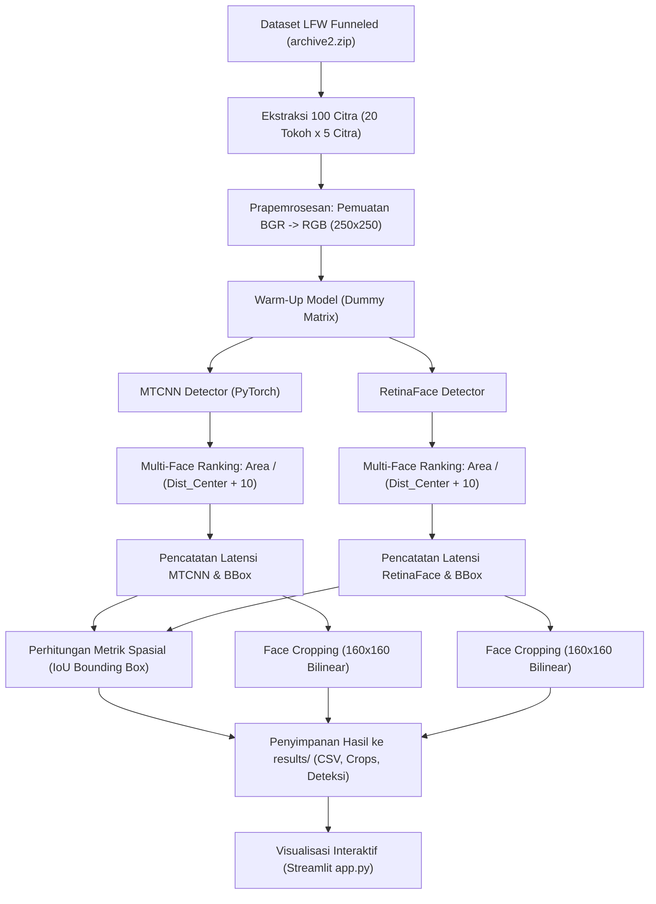

# RINGKASAN PROYEK & DOKUMEN PROGRES HANDOFF UNTUK AI
## Proyek PCD: Komparasi Kinerja Deteksi Wajah dan Face Cropping (MTCNN vs. RetinaFace)

> **Tujuan Dokumen Ini:**  
> Dokumen ini dirancang sebagai **Single Source of Truth (SSOT)** dan **Context Transfer Document** untuk model AI (seperti ChatGPT, Claude, Gemini, DeepSeek, atau agen otonom lainnya) agar dapat langsung memahami seluruh konteks proyek, inventaris kode, arsitektur sistem, data empiris hasil eksperimen, status pengerjaan saat ini, serta backlog rencana lanjutan tanpa mengalami halusinasi informasi.

---

## 🤖 PANDUAN UNTUK AI (INSTRUCTION PROTOCOL FOR NEXT AI AGENT)

Jika Anda adalah agen AI yang membaca file ini untuk melanjutkan atau mencatat progres proyek:
1. **Pertahankan Integritas Data Empiris**: Jangan mengubah angka kuantitatif benchmark aktual yang sudah diuji (Akurasi: 100%, MTCNN: 0.0621s, RetinaFace: 1.5717s, Rasio Kecepatan: 25.30×, Rata-rata IoU: 0.9083).
2. **Konteks Proyek**: Ini adalah proyek akademik mata kuliah **Pengolahan Citra Digital (PCD) Semester 9** dengan luaran draf artikel jurnal ilmiah (format template ITFORMAN / JOINS) serta dashboard evaluasi web interaktif berbasis Streamlit.
3. **Format Update Progres**: Jika Anda menambahkan fitur atau pengujian baru, perbarui bagian **"Tabel Status & Progress Tracker"** di bagian akhir dokumen ini dengan status `[x]` (selesai), `[/]` (sedang dikerjakan), atau `[ ]` (rencana/backlog).

---

## 📌 1. METADATA & IDENTITAS PROYEK

- **Nama Repositori / Workspace**: `pcd-mtcnn-vs-retinaface` (`d:\chiesaaaa\Semester 9\pcd`)
- **Mata Kuliah**: Pengolahan Citra Digital (PCD)
- **Tingkat Akademik**: Mahasiswa Semester 9 (Teknik Informatika / Sistem Informasi)
- **Topik Utama**: Evaluasi Komparatif Kinerja Model Deteksi Wajah Bertingkat (*Cascaded CNN* - MTCNN) versus Model Deteksi Wajah Satu Tahap Berbasis Piramida Fitur (*Single-Stage FPN* - RetinaFace) serta Pengaruhnya terhadap Pipeline Normalisasi *Face Cropping*.
- **Dataset Evaluasi**: *Labeled Faces in the Wild* (LFW Funneled Dataset), 100 citra uji dari 20 figur publik dunia.
- **Tech Stack**: Python 3.10+, PyTorch (`facenet-pytorch`), RetinaFace (`retina-face`), OpenCV (`opencv-python`), Streamlit, NumPy, Pandas, Matplotlib, Pillow.
- **Lingkungan Eksekusi Benchmark**: Central Processing Unit (CPU) dengan tahap *warm-up* inferensi.

---

## 📁 2. INVENTARIS LENGKAP STRUKTUR BERKAS & DIREKTORI

Berikut adalah seluruh berkas dan folder yang ada di dalam repositori proyek beserta fungsinya masing-masing:

```text
d:\chiesaaaa\Semester 9\pcd\
├── app.py                                          # [UTAMA] Aplikasi Web Dashboard Interaktif Streamlit (4 Modul)
├── run_experiment.py                               # [UTAMA] Skrip pipeline otomatis benchmark 100 citra & evaluasi
├── requirements.txt                                # Daftar paket pustaka Python yang dibutuhkan
├── .gitignore                                      # Konfigurasi pengabaian file Git (cache, zip, venv)
├── README.md                                       # Panduan cepat instalasi dan cara menjalankan aplikasi
│
├── HASIL_EKSPERIMEN_DAN_LAPORAN_PROYEK.md          # Dokumen komprehensif (43KB) data mentah + panduan penulisan jurnal ilmiah
├── RINGKASAN_PROYEK_DAN_PROGRES.md                 # [FILE INI] Ringkasan eksekutif untuk handoff AI & tracking progres
├── Draf_Jurnal_MTCNN_RetinaFace_ITFORMAN_Kelompok1.docx # Manuskrip publikasi ilmiah draf Word (Template ITFORMAN)
├── ITFORMAN Template.docx                          # Dokumen acuan format penulisan jurnal ITFORMAN
├── pengumpulan jurnal.xlsx                         # Lembar spreadsheet koordinasi pengumpulan tugas / jurnal
│
├── dataset_selected/                               # Direktori 100 citra uji LFW terpilih (format JPG, 250x250 px)
├── foto_asli_100/                                  # Folder replika/cadangan 100 citra asli untuk referensi
├── results/                                        # Direktori seluruh artefak keluaran eksperimen
│   ├── comparison.csv                              # Rekap tabular 100 baris berisi metrik latensi, bbox, dan status
│   ├── visual_comparison.png                       # Grafik komparasi performa dan visualisasi grid
│   ├── mtcnn/
│   │   ├── crops/                                  # 100 file citra wajah hasil cropping MTCNN (160x160 px)
│   │   └── detection/                              # 100 file citra visualisasi bounding box & 5 landmark MTCNN
│   └── retinaface/
│       ├── crops/                                  # 100 file citra wajah hasil cropping RetinaFace (160x160 px)
│       └── detection/                              # 100 file citra visualisasi bounding box & 5 landmark RetinaFace
│
└── [Berkas Arsip / Dataset Mentah]
    ├── archive.zip                                 # Arsip dataset LFW mentah original
    ├── archive2.zip                                # Arsip LFW terkompresi (sumber ekstraksi 100 citra)
    ├── croped2/ & croped2.zip                      # Arsip eksperimen cropping tahap awal
    └── foto_asli_100.zip                           # File zip kompresi 100 foto asli uji
```

---

## 🔬 3. METODOLOGI & ALUR KERJA SISTEM (PIPELINE)

Pipeline pemrosesan dan pengujian dirancang secara konsisten melalui langkah-langkah berikut:



### 3.1 Karakteristik Dua Model yang Dibandingkan:
1. **MTCNN (Multi-Task Cascaded Convolutional Networks)**:
   - **Arsitektur**: Pendekatan bertahap *coarse-to-fine* 3-tahap (P-Net 12×12 $\to$ R-Net 24×24 $\to$ O-Net 48×48).
   - **Mekanisme**: Memanfaatkan piramida citra (*image pyramid*) untuk *scale invariance* dan Non-Maximum Suppression (NMS) pada setiap tahap. Mengeluarkan Bounding Box dan 5 Facial Landmark Points.
   - **Karakteristik Bounding Box**: *Slack bounding box* (cenderung longgar, menyertakan margin dahi atas dan telinga).
   - **Kelebihan**: Sangat ringan (~2 MB), latensi luar biasa rendah pada CPU, sangat cocok untuk sistem real-time/edge device.

2. **RetinaFace (Single-Stage Dense Face Localization)**:
   - **Arsitektur**: Single-stage detector berbasis Feature Pyramid Network (FPN $P_2 - P_5$) yang dipadukan dengan Deformable Convolutional Networks (DCN) dan Context Module.
   - **Mekanisme**: Multi-task dense supervision simultan (Face classification, Box regression, 5 landmarks, dan Dense 3D mesh).
   - **Karakteristik Bounding Box**: *Tight bounding box* (sangat pas membatasi kontur anatomis wajah dari alis hingga dagu).
   - **Kelebihan**: Presisi lokalisasi tinggi, tangguh pada wajah berskala kecil/ekstrem. Beban komputasi tinggi pada CPU.

### 3.2 Strategi Seleksi Wajah Terbaik (Best Face Selection):
Untuk menangani citra yang memuat orang lain di latar belakang secara objektif, digunakan fungsi pemeringkatan:
$$\text{Score}_{\text{rank}} = \frac{\text{Area}(B)}{\sqrt{(c_x - c_x^{\text{img}})^2 + (c_y - c_y^{\text{img}})^2} + 10}$$

### 3.3 Normalisasi Cropping Wajah:
Seluruh area wajah yang terdeteksi dipotong (*matrix slicing*) lalu di-resize ke dimensi standar **160 × 160 piksel** dengan interpolasi bilinear (`cv2.INTER_LINEAR`), sesuai standar dimensi input model pengenalan wajah FaceNet / Inception-ResNet-v1.

---

## 📊 4. HASIL BENCHMARK LENGKAP & ANALISIS DATA

### 4.1 Tabel Komparasi Kinerja Utama (100 Citra Uji)

| Parameter Metrik Evaluasi | MTCNN (Cascaded CNN) | RetinaFace (Single-Stage FPN) | Selisih / Rasio Komparasi |
| :--- | :---: | :---: | :--- |
| **Total Sampel Uji** | 100 citra | 100 citra | Sampel identik berimbang (20 tokoh × 5) |
| **Tingkat Keberhasilan Deteksi** | **100.0% (100/100)** | **100.0% (100/100)** | Keduanya mencapai akurasi sempurna (*zero miss*) |
| **Tingkat Keberhasilan Cropping** | **100.0% (100/100)** | **100.0% (100/100)** | 100% citra dinormalisasi ke 160×160 piksel |
| **Rata-rata Waktu Inferensi (Mean)** | **0.0621 detik (62.1 ms)** | **1.5717 detik (1571.7 ms)** | **MTCNN 25.30× lebih cepat** |
| **Median Waktu Inferensi** | **0.0554 detik (55.5 ms)** | **1.5411 detik (1541.1 ms)** | MTCNN 27.8× lebih cepat pada median |
| **Standar Deviasi Waktu** | ± 0.0256 detik | ± 0.1620 detik | Stabilitas MTCNN sangat tinggi |
| **Waktu Tercepat (Min)** | 0.0371 detik (37.1 ms) | 1.3219 detik (1321.9 ms) | MTCNN 35.6× lebih cepat |
| **Waktu Terlama (Max)** | 0.1963 detik (196.3 ms) | 2.2188 detik (2218.8 ms) | RetinaFace mencapai >2.2 detik |
| **Total Waktu 100 Citra** | **6.2115 detik** | **157.1713 detik** | MTCNN selesai 6.2s vs RetinaFace 2.6 menit |
| **Rata-rata IoU Antar Model** | \multicolumn{2}{c|}{**0.9083 (90.83%)**} | Kesepakatan lokalisasi spasial sangat tinggi |

### 4.2 Analisis Derajat Kesepakatan Spasial (IoU)
- **Mean IoU**: `0.9083` (90.83%)
- **Median IoU**: `0.9101` (91.01%)
- **Standar Deviasi IoU**: `0.0350`
- **Rentang Nilai IoU**: Minimum `0.8055` (pada `Andre_Agassi_0003.jpg`), Maksimum `0.9778` (pada `Vladimir_Putin_0001.jpg`).
- **Distribusi Kategori**:
  - IoU $\ge 0.90$ (Sangat Selaras / Nyaris Identik): **68 citra (68.0%)**
  - $0.80 \le \text{IoU} < 0.90$ (Selaras Kuat): **32 citra (32.0%)**
  - $\text{IoU} < 0.80$ (Perbedaan Spasial): **0 citra (0.0%)**
- **Interpretasi**: 100% sampel memiliki IoU $\ge 0.80$. Ini membuktikan bahwa perbedaan waktu eksekusi yang masif (25.3x) sama sekali tidak mengorbankan kualitas dan keselarasan lokalisasi wajah secara umum.

### 4.3 Ringkasan Rata-Rata per 20 Tokoh Publik

| No | Nama Tokoh Publik | Jumlah Citra | Waktu MTCNN (s) | Waktu RetinaFace (s) | Rata-rata IoU |
| :---: | :--- | :---: | :---: | :---: | :---: |
| 1 | Andre Agassi | 5 | 0.0699 | 1.6274 | 0.8767 |
| 2 | Ariel Sharon | 5 | 0.0607 | 1.5644 | 0.8857 |
| 3 | Arnold Schwarzenegger | 5 | 0.0479 | 1.3801 | 0.9181 |
| 4 | Colin Powell | 5 | 0.0828 | 1.6492 | 0.9024 |
| 5 | Donald Rumsfeld | 5 | 0.0522 | 1.5398 | 0.8989 |
| 6 | George W Bush | 5 | 0.0763 | 1.7245 | 0.9065 |
| 7 | Gerhard Schroeder | 5 | 0.0553 | 1.5422 | 0.9332 |
| 8 | Gloria Macapagal Arroyo | 5 | 0.0516 | 1.5030 | 0.9226 |
| 9 | Hans Blix | 5 | 0.0754 | 1.7745 | 0.8930 |
| 10 | Hugo Chavez | 5 | 0.0471 | 1.5736 | 0.9057 |
| 11 | Jacques Chirac | 5 | 0.0546 | 1.5256 | 0.9111 |
| 12 | Jennifer Capriati | 5 | 0.0810 | 1.5066 | 0.8791 |
| 13 | Junichiro Koizumi | 5 | 0.0592 | 1.7885 | 0.9271 |
| 14 | Kofi Annan | 5 | 0.0676 | 1.6784 | 0.8982 |
| 15 | Laura Bush | 5 | 0.0555 | 1.3569 | 0.9210 |
| 16 | Luiz Inacio Lula da Silva | 5 | 0.0660 | 1.4760 | 0.8962 |
| 17 | Megawati Sukarnoputri | 5 | 0.0594 | 1.5827 | 0.9322 |
| 18 | Serena Williams | 5 | 0.0611 | 1.5021 | 0.9454 |
| 19 | Tony Blair | 5 | 0.0619 | 1.5489 | 0.9143 |
| 20 | Vladimir Putin | 5 | 0.0568 | 1.5900 | 0.8995 |

### 4.4 Studi Kasus Visual Kualitatif (6 Tantangan Pengujian):
1. **Frontal Wajah Standar** (`Colin_Powell_0001.jpg`): IoU = **0.9362**. Kedua model menghasilkan bounding box yang saling berimpit hampir sempurna.
2. **Pose Non-Frontal / Miring** (`George_W_Bush_0002.jpg`): IoU = **0.9017**. RetinaFace sedikit memperluas margin vertikal ke rahang bawah, MTCNN fokus pada batas dagu.
3. **Aksesoris Kacamata & Refleksi Lensa** (`Hans_Blix_0001.jpg`): IoU = **0.9029**. Refleksi kaca tidak mengaburkan deteksi pupil mata pada landmark 5-titik kedua model.
4. **Ekspresi Dinamis / Senyum Lebar** (`Jennifer_Capriati_0001.jpg`): IoU = **0.8445**. Perubahan otot pipi membuat RetinaFace sedikit memperlebar box ke rambut samping.
5. **Pose Berbicara / Mulut Terbuka** (`Tony_Blair_0002.jpg`): IoU = **0.9486**. Bounding box kedua model konsisten mengikuti posisi dagu yang merendah saat berbicara.
6. **Struktur Rambut & Variasi Pencahayaan** (`Megawati_Sukarnoputri_0001.jpg`): IoU = **0.9221**. Rambut yang menutupi sebagian dahi dan telinga tidak memengaruhi kualitas cropping wajah 160×160 piksel.

---

## 💻 5. FITUR SISTEM APLIKASI WEB (`app.py`)

Aplikasi dashboard web berbasis Streamlit dibangun dengan 4 modul utama:
1. **Modul 1: Uji Deteksi Interaktif (Side-by-Side Test)**
   - Mendukung 4 sumber citra input: Dataset LFW terpilih, direktori citra mentah, unggah file lokal (JPG/PNG), serta tangkapan kamera langsung (*webcam capture*).
   - Menampilkan visualisasi berdampingan (3 kolom): Citra Asli, Hasil Deteksi MTCNN (BBox oranye + 5 landmark kuning), dan Hasil Deteksi RetinaFace (BBox hijau + 5 landmark merah).
   - Menampilkan metrik seketika: Confidence Score, Latensi Inferensi, Rasio Kecepatan, dan Nilai IoU.
   - Menyediakan fitur download hasil crop 160×160 piksel langsung dari UI.
2. **Modul 2: Hasil Eksperimen 100 Citra**
   - KPI Cards: Total citra (100), Akurasi MTCNN (100%), Akurasi RetinaFace (100%), Rata-rata Rasio Kecepatan (25.3x).
   - Grafik garis interaktif perbandingan waktu komputasi per citra.
   - Tabel eksplorasi data dengan fitur filter nama tokoh publik dan tombol unduh data `comparison.csv`.
### 4.5 Hasil Eksperimen Preprocessing Citra (Brightness, Contrast, CLAHE)
Dievaluasi pengaruh 4 skenario transformasi citra terhadap deteksi wajah pada 100 citra uji:
- **Original**: Baseline tanpa perubahan ($\alpha=1.0, \beta=0$).
- **Brightness**: Peningkatan kecerahan linier ($\alpha=1.0, \beta=30$).
- **Contrast**: Peningkatan kontras global ($\alpha=1.3, \beta=0$).
- **CLAHE**: Local contrast enhancement pada kanal L ruang warna LAB (`clipLimit=2.0`, `tileGridSize=(8,8)`).

| Skenario | Waktu Preproc (ms) | MTCNN Det Rate | MTCNN Avg Infer | RetinaFace Det Rate | RetinaFace Avg Infer | Inter-Model IoU |
| :--- | :---: | :---: | :---: | :---: | :---: | :---: |
| **Original** | 0.03 ms | 100/100 (100.0%) | 0.0626 s | 100/100 (100.0%) | 1.2872 s | 0.9083 |
| **Brightness** | 0.09 ms | 100/100 (100.0%) | 0.0553 s | 100/100 (100.0%) | 1.3168 s | 0.9033 |
| **Contrast** | 0.09 ms | 100/100 (100.0%) | 0.0609 s | 100/100 (100.0%) | 1.3240 s | 0.8985 |
| **CLAHE** | 4.93 ms | 100/100 (100.0%) | 0.0752 s | 100/100 (100.0%) | 1.3237 s | 0.9040 |

*Catatan: Dataset LFW tidak menyediakan ground-truth bounding box manual. Metrik IoU yang dilaporkan adalah Inter-Model IoU (derajat kesepakatan spasial antara MTCNN dan RetinaFace).*

---

## 💻 5. FITUR SISTEM APLIKASI WEB (`app.py`)

Aplikasi dashboard web berbasis Streamlit dibangun dengan 5 modul utama:
1. **Modul 1: Uji Deteksi Interaktif (Side-by-Side Test)**
   - Mendukung 4 sumber citra: Dataset LFW terpilih, direktori citra mentah, unggah file lokal, dan kamera langsung (*webcam*).
2. **Modul 2: Hasil Eksperimen 100 Citra (Baseline)**
   - KPI Cards, grafik garis waktu komparatif, tabel eksplorasi data dengan filter, dan tombol unduh CSV.
3. **Modul 3: Galeri Dataset & Crop Wajah**
   - Grid inspeksi 5 kolom (Asli 250×250, RetinaFace BBox, RetinaFace Crop 160×160, MTCNN BBox, MTCNN Crop 160×160).
4. **Modul 4: Eksperimen Preprocessing (Brightness, Contrast, CLAHE)**
   - Tab 1: Ringkasan KPI 4 skenario, tabel rekapitulasi, grafik komparasi waktu & IoU, visual summary grid, filter per skenario, dan unduh `preprocessing_comparison.csv`.
   - Tab 2: Uji coba interaktif langsung dengan slider beta (brightness), alpha (contrast), dan clip limit (CLAHE).
5. **Modul 5: Teori & Analisis Metode PCD**
   - Dokumentasi interaktif mengenai teori Cascaded CNN, Feature Pyramid Network, Deformable Convolutions, serta tabel matriks kelebihan dan kekurangan.

---

## 📋 6. PROGRESS TRACKER & STATUS KESIAPAN PROYEK

| No | Modul / Komponen Proyek | Status | Keterangan & Catatan |
| :---: | :--- | :---: | :--- |
| 1 | **Ekstraksi Dataset LFW (100 citra)** | `[x] Selesai` | 20 tokoh × 5 citra dari `archive2.zip` ke `dataset_selected/` |
| 2 | **Skrip Evaluasi Otomatis (`run_experiment.py`)** | `[x] Selesai` | Pipeline benchmark, warmup, ranking multi-face, IoU, normalisasi crop |
| 3 | **Eksekusi Eksperimen Benchmark Baseline** | `[x] Selesai` | 100 citra diproses penuh, menghasilkan `results/comparison.csv` |
| 4 | **Penyimpanan Artefak Crops & Deteksi** | `[x] Selesai` | 100 crop MTCNN, 100 crop RetinaFace (160×160 px), dan citra anotasi BBox |
| 5 | **Eksperimen Preprocessing (Brightness, Contrast, CLAHE)** | `[x] Selesai` | 4 skenario dieksekusi penuh pada 100 citra (`preprocessing_comparison.csv`) |
| 6 | **Aplikasi Dashboard Interaktif (`app.py`)** | `[x] Selesai` | Streamlit 5 modul (Baseline + Preprocessing live & batch) |
| 7 | **Dokumen Laporan Komprehensif** | `[x] Selesai` | Tersimpan di `HASIL_EKSPERIMEN_DAN_LAPORAN_PROYEK.md` (43 KB) |
| 8 | **Draf Manuskrip Publikasi Jurnal (ITFORMAN)** | `[x] Selesai` | Berkas Word `Draf_Jurnal_MTCNN_RetinaFace_ITFORMAN_Kelompok1.docx` |
| 9 | **File Ringkasan Progres Handoff AI** | `[x] Selesai` | Berkas ini (`RINGKASAN_PROYEK_DAN_PROGRES.md`) diperbarui sebagai SSOT |
| 10 | **Uji Coba Akselerasi GPU (CUDA/TensorRT)** | `[ ] Backlog` | Evaluasi apakah latensi RetinaFace dapat ditekan <50 ms pada GPU |
| 11 | **Integrasi Face Recognition (FaceNet/ArcFace)** | `[ ] Backlog` | Menguji akurasi verifikasi (Cosine Similarity) pada crop MTCNN vs RetinaFace |
| 12 | **Pengujian Oklusi Berat & Kondisi Ekstrem** | `[ ] Backlog` | Menguji ketahanan pada dataset WIDER FACE / wajah berskala <15 px |
| 13 | **Finalisasi & Submit Jurnal Ilmiah** | `[ ] Backlog` | Koordinasi revisi dengan dosen pembimbing dan submit via OJS |

---

## 🚀 7. CARA MENJALANKAN SISTEM (REPRODUCIBILITY GUIDE)

### Instalasi Dependensi:
```bash
pip install -r requirements.txt
```

### Menjalankan Uji Eksperimen Ulang:
```bash
python run_experiment.py
```
*Catatan: Skrip akan membaca gambar dari `archive2.zip`, menjalankan detektor MTCNN dan RetinaFace, menghitung IoU, menyimpan crop 160×160 piksel, dan memperbarui `results/comparison.csv`.*

### Menjalankan Dashboard Streamlit:
```bash
streamlit run app.py
```
*Aplikasi akan terbuka otomatis di browser pada `http://localhost:8501`.*

---

## 💡 8. REKOMENDASI PENGGUNAAN HASIL PENELITIAN

1. **Gunakan MTCNN Jika**:
   - Sistem membutuhkan responsivitas tinggi / *real-time video processing* (mampu mencapai 15-20 FPS pada CPU standar).
   - Diterapkan pada perangkat berdaya rendah (*Edge AI, Raspberry Pi, IoT, Smartphone*).
   - Output ditujukan untuk *face recognition pipeline* umum yang memerlukan ruang di sekitar rambut dan pelipis (*slack bounding box*).

2. **Gunakan RetinaFace Jika**:
   - Sistem berfokus pada analisis biometrik presisi tinggi, estimasi pose kepala 3D, atau deteksi mikro-ekspresi.
   - Skenario pengawasan keamanan (*surveillance*) dengan kerumunan orang (*crowded scene*) dan wajah berukuran sangat kecil (<20 piksel).
   - Tersedia kartu akselerasi grafis (GPU dedicated) di server.
